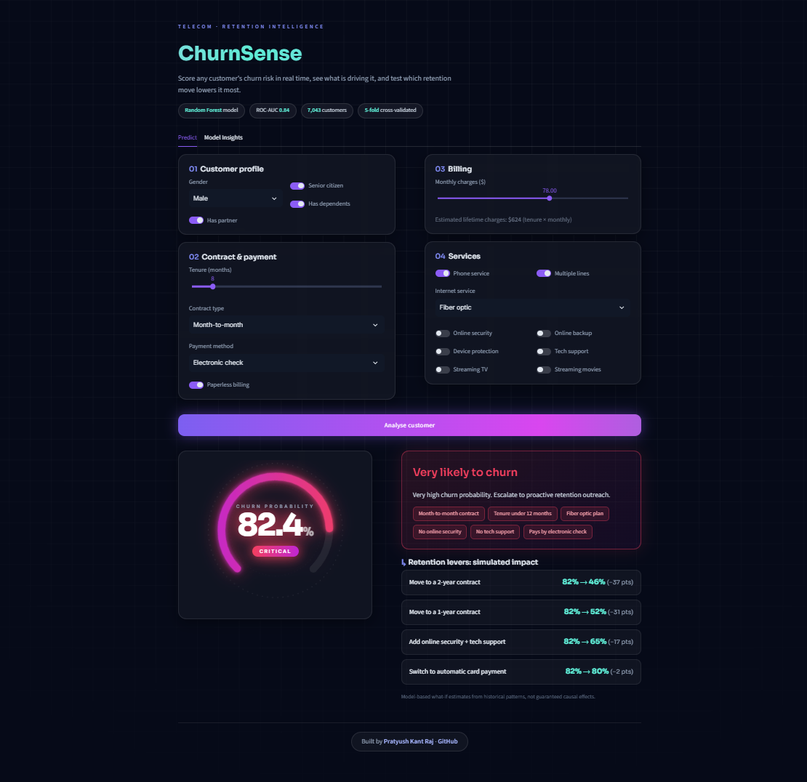
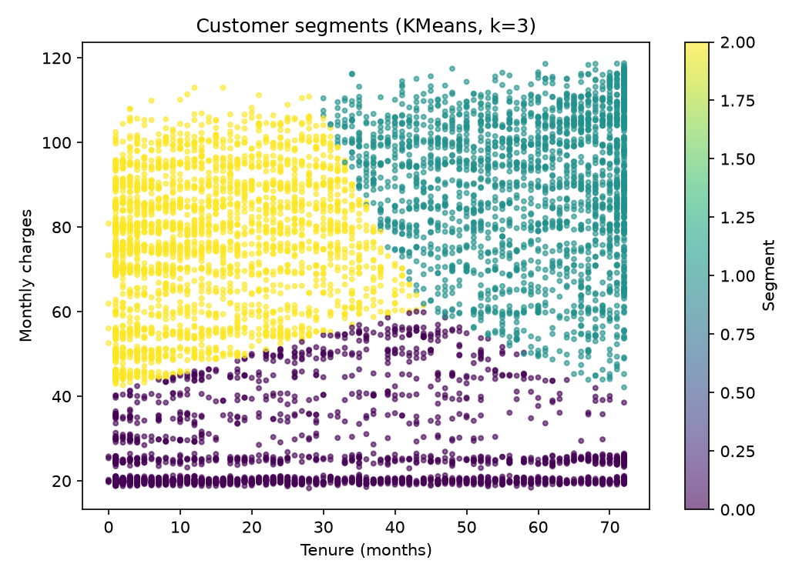
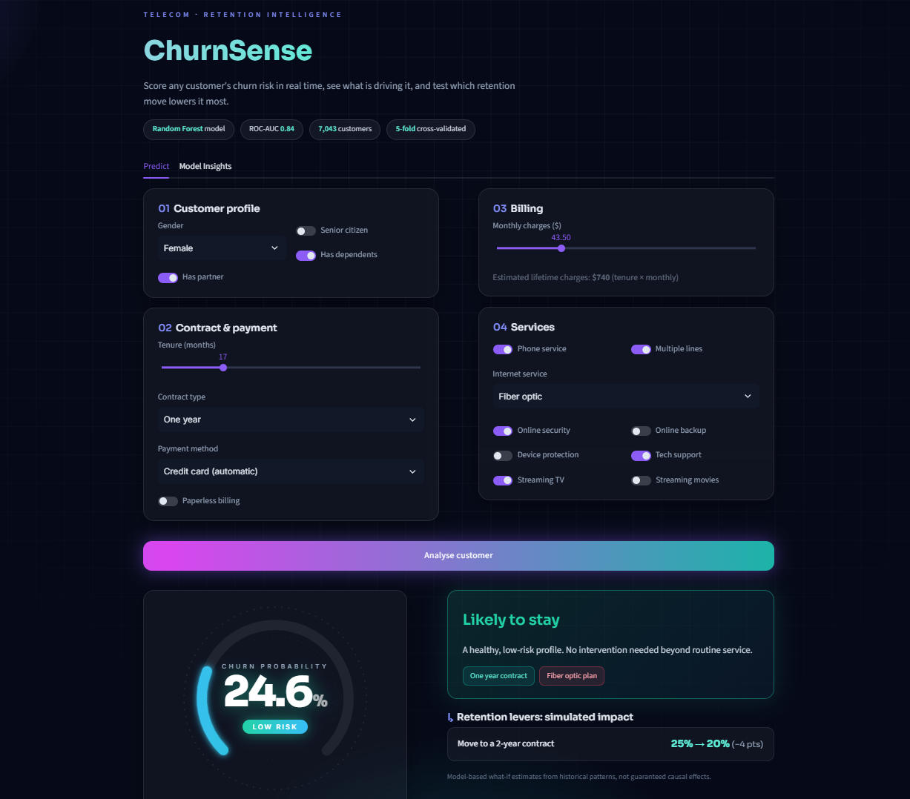
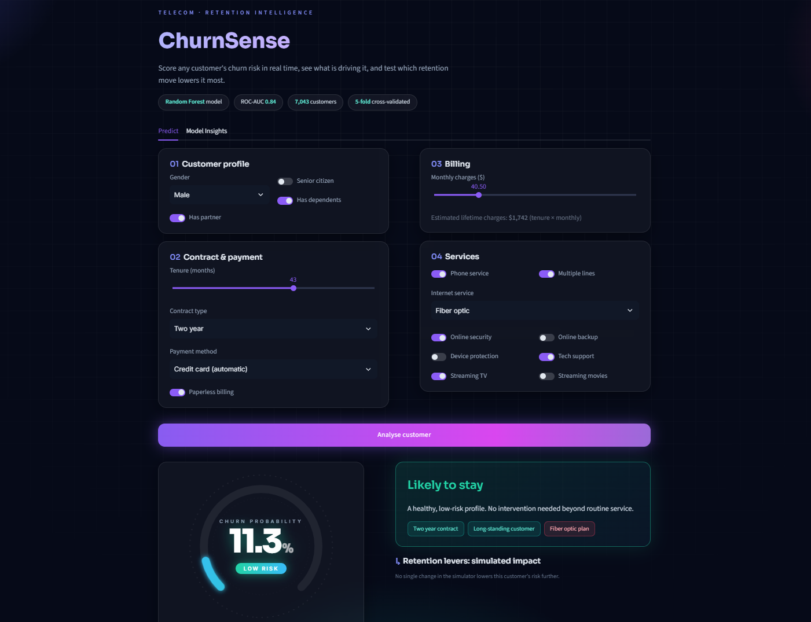
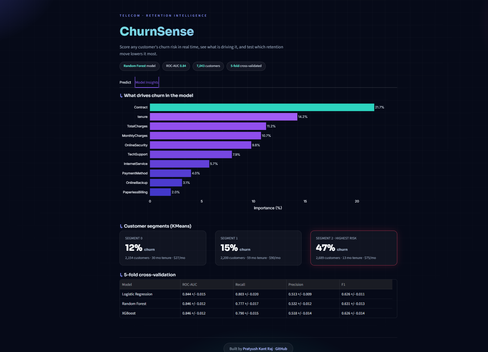

# ChurnSense: Customer Churn Prediction & Analytics

    

A machine learning pipeline that predicts whether a telecom customer will cancel their subscription, segments customers by behaviour, and serves the results through an interactive Streamlit app with a what-if retention simulator.

**🔗 Live demo: https://customer-churn-prediction-analysis-pkr05.streamlit.app/**



---

## 📌 Executive Summary

Acquiring a customer typically costs more than retaining one, so predicting who is about to leave, and why, lets a business act before the revenue is lost. This project trains and compares three classifiers on 7,043 telecom customer records, validates them with 5-fold cross-validation, segments customers with KMeans, and wraps the selected model in a live prediction tool.

### Key Outcomes

- Logistic Regression, Random Forest and XGBoost all reach **ROC-AUC ≈ 0.84–0.85**. The models are statistically very close, which suggests the available features, not the algorithm, limit performance.
- Contacting the **top 20% of customers ranked by predicted risk captures 50.5% of all churners** (2.5x lift over random targeting).
- **Contract type (21.7%) and tenure (14.2%)** are the strongest churn drivers.
- KMeans isolates a **new-customer segment that churns at 47%**, against 12–15% for the other two segments.
- The Streamlit app returns a live churn probability, flags the risk signals behind it, and simulates which retention change lowers the risk most.

---

## 🛠️ Tech Stack

| Layer | Tools |
|---|---|
| Language | Python 3.10+ |
| Data processing | pandas, numpy |
| Modeling | scikit-learn (Logistic Regression, Random Forest, KMeans), XGBoost |
| Visualization | matplotlib, seaborn, plotly |
| Web app | Streamlit |
| Model persistence | joblib |

---

## 📁 Project Structure

```
Customer-Churn-Prediction-Analysis/
│
├── data/
│   └── telco_churn.csv          # Telco Customer Churn dataset (7,043 records)
│
├── models/
│   ├── churn_model.pkl          # Trained Random Forest (used by the app)
│   ├── scaler.pkl               # StandardScaler (used for Logistic Regression)
│   ├── encoders.pkl             # LabelEncoders for categorical columns
│   ├── columns.pkl              # Expected feature order
│   ├── cv_results.csv           # 5-fold cross-validation results
│   ├── segment_summary.csv      # KMeans segment profiles
│   ├── segments.png             # Segment scatter plot
│   ├── feature_importance.png   # Top 10 churn drivers
│   └── confusion_matrix.png     # Random Forest confusion matrix
│
├── .streamlit/config.toml       # Dark theme for the app
├── train_model.py               # Cleans data, trains and compares 3 models, runs CV
├── segmentation.py              # KMeans customer segmentation
├── app.py                       # Streamlit app
├── requirements.txt
└── README.md
```

---

## 📊 Dataset

The [Telco Customer Churn dataset](https://www.kaggle.com/datasets/blastchar/telco-customer-churn) from Kaggle: 7,043 customers, 21 features, with roughly 26% churn.

| Category | Columns | Description |
|---|---|---|
| Demographics | gender, SeniorCitizen, Partner, Dependents | Basic customer attributes |
| Services | PhoneService, InternetService, OnlineSecurity, TechSupport, StreamingTV, etc. | Subscribed add-ons |
| Account | tenure, Contract, PaperlessBilling, PaymentMethod, MonthlyCharges, TotalCharges | Billing and contract terms |
| Target | Churn | Yes / No: whether the customer left |

**Preprocessing:** blank `TotalCharges` values were converted to numeric and filled with the median; the customer ID was dropped; categorical columns were label-encoded; and class weighting handled the ~26% churn rate.

---

## 📈 Model Performance

All models used an 80/20 stratified train-test split. ROC-AUC is computed from predicted probabilities.

| Model | Accuracy | Precision | Recall | F1-Score | ROC-AUC |
|---|---|---|---|---|---|
| Logistic Regression | 74.0% | 0.506 | 0.797 | 0.619 | 0.840 |
| **Random Forest (selected)** | **75.9%** | **0.531** | 0.786 | **0.634** | 0.842 |
| XGBoost | 74.7% | 0.516 | 0.778 | 0.620 | 0.845 |

### 5-Fold Stratified Cross-Validation (mean ± std)

| Model | ROC-AUC | Recall | Precision | F1 |
|---|---|---|---|---|
| Logistic Regression | 0.844 ± 0.015 | 0.803 ± 0.020 | 0.513 ± 0.009 | 0.626 ± 0.011 |
| Random Forest | 0.846 ± 0.012 | 0.777 ± 0.017 | 0.532 ± 0.012 | 0.631 ± 0.013 |
| XGBoost | 0.846 ± 0.012 | 0.790 ± 0.015 | 0.518 ± 0.014 | 0.626 ± 0.014 |

**Why Random Forest?** It has the best accuracy, precision and F1 on the hold-out set. However, all three models are within noise of each other (AUC differences are smaller than the fold-to-fold standard deviation), so the choice is a practical one rather than a statistical win.

**Why recall matters here:** missing a customer who is about to leave costs more than contacting one who would have stayed, so the models are tuned to favour recall at the expense of precision (about half of flagged customers will not actually churn).

### Business Impact

Ranking customers by predicted churn probability and contacting only the **top 20% reaches 50.5% of all churners**, a **2.53x lift** over contacting a random 20%.

---

## 💡 Top Churn Drivers

Random Forest feature importance:

| Feature | Importance |
|---|---|
| Contract | 21.7% |
| tenure | 14.2% |
| TotalCharges | 11.2% |
| MonthlyCharges | 10.7% |
| OnlineSecurity | 9.8% |
| TechSupport | 7.9% |

Customers on month-to-month contracts with short tenure and no security or support add-ons carry the highest risk.

---

## 👥 Customer Segmentation (KMeans)

Customers were clustered on tenure, monthly charges and total charges (standardised, k = 3 chosen for interpretability; k = 2 has a slightly higher silhouette score of 0.48 vs 0.45).

| Segment | Customers | Avg. tenure (months) | Avg. monthly charges | Churn rate |
|---|---|---|---|---|
| Low-spend, mid-tenure | 2,154 | 29.5 | $26.57 | 12% |
| Loyal, high-spend | 2,200 | 58.6 | $89.70 | 15% |
| **New, mid-to-high spend** | 2,689 | 13.3 | $74.95 | **47%** |

New customers on mid-to-high plans churn at roughly 3–4x the rate of the other segments, making early-tenure retention the clearest priority.



---

## 🚀 App Features

- **Live prediction:** set a customer's profile, contract, billing and services, and get an animated churn-probability gauge with a risk tier.
- **Risk signals:** plain-language flags explaining what is driving the score (for example, month-to-month contract, no tech support).
- **Retention levers:** a what-if simulator that re-scores the same customer after one change, such as a longer contract or added security, and shows the drop in risk.
- **Model Insights tab:** live feature importance, KMeans segments and cross-validation results.

### Screenshots

**1. Customer input form.** Profile, contract, billing and service details are set with toggles and sliders. Add-ons switch off automatically when a customer has no internet service.



**2. High-risk prediction.** A new month-to-month fiber customer (3 months tenure, $70/month, electronic check, no security or support add-ons) scores about **82% churn probability (Critical)**. The risk signals list what is driving the score, and the retention levers show how much each change would lower it.


**3. Low-risk prediction.** A long-standing customer (60 months tenure, two-year contract, DSL, $50/month, online security and tech support, automatic card payment) scores about **11% (Low risk)**.



**4. Model Insights tab.** Live feature importance from the trained model, the three KMeans customer segments (with the 47%-churn segment highlighted), and the 5-fold cross-validation results.




---

## 💻 Getting Started

```bash
git clone https://github.com/PratyushRaj0512/Customer-Churn-Prediction-Analysis.git
cd Customer-Churn-Prediction-Analysis

python -m venv venv
# Windows:
venv\Scripts\activate
# macOS/Linux:
source venv/bin/activate

pip install -r requirements.txt
streamlit run app.py
```

Open http://localhost:8501 in your browser.

To retrain the models and regenerate the metrics:

```bash
python train_model.py      # trains 3 models, runs 5-fold CV, saves artifacts
python segmentation.py     # KMeans segmentation, saves segment summary and plot
```

---

## ⚠️ Limitations

- **Probabilities are not calibrated.** Class weighting shifts the model's scores upward, so a displayed 70% means "resembles customers who usually churn", not a literal 70% chance.
- **The retention levers are model-based estimates** learned from historical patterns. They indicate association, not guaranteed causal effects.
- **One dataset.** Results come from a single public telecom dataset and would need validation on a company's own data before any real use.

---

## 🗺️ Future Improvements

- [ ] SHAP-based explanations for individual predictions
- [ ] Probability calibration and decision-threshold tuning based on retention cost vs. churn cost
- [ ] Hyperparameter search for Random Forest and XGBoost
- [ ] Batch-prediction mode (upload a CSV, get churn scores for every row)

---

## 📄 License

Distributed under the MIT License.